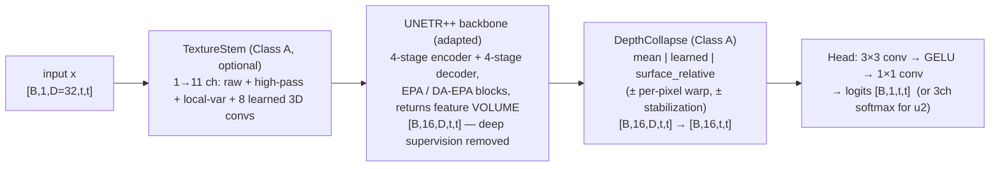

# UNETR++ Ink Detection — FINAL CONSOLIDATED REPORT (deep version)
### Architecture · every trial from outputs → outputs6 + output_inter · interpretation · figures · thesis mapping

**Project:** MSc thesis, FAU Pattern Recognition Lab · ink detection in carbonized papyrus scrolls, Scroll 5 (PHerc 0172, Unlost project)
**Study window:** 2026-06-24 → 2026-07-19 · **Written:** 2026-07-19 (pass 2 — full detail)
**Companions:** `plan.md` §14 (execution log), `DEEP_DIVE_TUTORIAL_unetrpp.md` (pedagogy), `vesuvius_final_report.md` (original-study report). This file is the single consolidated reference.
**Roots:** `$WORK/vesuvius/` → `outputs/` (original study, 44 runs) · `outputs2/` (t192 screens + analyses) · `outputs3/` (t64 fixed-loop ablations) · `outputs4/` (t256/t320) · `outputs5/` (final combo) · `outputs6/` (geometry closing) · `output_inter/` (interpretability probes).

**HEADLINE:** baseline a0 **0.416** → best single **c1_t256_s42 post-filter 0.8261** · best 3-seed pipeline **c1_t256 post 0.8190 ± 0.0062** · best TTA-rescored **0.8199** (t256_lean_s42; c1+TTA not yet rescored, expected ≈ 0.83). Final post-filter IoU_ink **0.599** / IoU_bg **0.911** (c1_s42).

---
---

# PART 0 — SETUP (fixed throughout)

- **Data:** 9 labelled segments, 65 surface layers each (uint8). Sizes (H,W): 145341 (1340,7620) · 145701 (1340,7520) · 152031 (10580,22000) · 111522 (7420,4820) · 115232 (7380,4400) · 120732 (7440,4800) · 070770 (1580,11360) · 080880 (1600,11400) · 090990 (1620,11480). Ink fraction 5.3–15.8%. Test: flatboi (49240×11140, no labels → qualitative only).
- **Split (Fei Wu, fixed):** train = 8 segments · **val = 20241113090990** (all selection + all reported metrics) · test = flatboi (never scored).
- **Input:** depth window [16,48) of 65 (32 layers, centred on 32), intensity /255, tile t×t in-plane, stride t/2 (train manifests + inference), Gaussian-blended sliding-window inference.
- **Metric:** masked F0.5 vs **registered** labels (`ink_reg.npy`); τ swept ∈ {0.10…0.90}; selection + early stop on swept F0.5; "post" = 8-connected component min-size filter, (τ, ms) selected on val. **IoU (ink/bg/mean) reported, never selected on.** Noise floor: single-seed |Δ| ≤ 0.008 (measured, §3.1.6).
- **Recipe (final form):** dice_bce (w=0.5) · AdamW lr 1e-4, wd 3e-5 · warmup 3 → cosine to 60 epochs · patience 20 · grad-clip 1 · `samples_per_epoch` 4000, 1:1 pos-tile oversampling (pos_thresh 0.05) · aug hflip/vflip/rot90 (p.5) + z_shift ±2 (p.3) [+ z_flip p.5 until it was measured harmful] · batch 16/8/4/4/2 at t64/128/192/256/320 · fp16 below t192, **bf16 at t192+** · seeds 42/43/44.

---
---

# PART 1 — THE ARCHITECTURE, IN DETAIL

## 1.1 The unified model (identical wrapper for every candidate)

Design rule used everywhere: **every component starts as an exact no-op behind a default-off flag** (γ_da=0.1≈identity gate, zero-init ŝ heads, `warp_stabilize` flag, `pe_mode` default) — that is why every ablation is a genuine single toggle and why parameter counts verify each rung.

## 1.2 The backbone: adapted UNETR++ (Shaker et al., IEEE TMI 2024)

- 4 encoder stages, dims [32,64,128,256], 3 EPA blocks/stage, 4 heads; convolutional downsampling between stages; symmetric decoder with skip connections + a full-resolution conv skip (`encoder1` → last decoder) that substitutes for the removed deep supervision. Patch embed **(1,4,4)** (depth-preserving, from A0b) with **2D positional embedding tiled across depth** (the axis-trap fix).
- **EPA block** (per block): one linear produces shared **Q,K** and two values **v_CA, v_SA**. Q,K are **L2-normalized** ⇒ cosine attention with **learnable per-head temperatures** (no /√d).
  - **Channel branch:** `A_CA = softmax(Q·Kᵀ · T₁)` of shape **[C/h × C/h]** (contracts over tokens) → "which feature channels co-activate globally?"
  - **Spatial branch (Linformer):** K,V projected along the *token* axis N→p (proj_size per stage = **(64, 64, 64, 32)**, verified in `unetr_pp_ink.py`) by a **shared** linear (E=F, one object): `A_SA = softmax(Qᵀ·K_p · T₂)` of shape **[N × p]** → O(N·p), linear in tokens. Consequence: **token identity is destroyed in K/V** — the reason standard ViT interpretability (rollout/Chefer/BertViz) does not apply (§4.6).
  - **Fusion = concatenation of two half-width projections** (`out_proj`, `out_proj2`: C→C/2 each, then concat) — *not* addition (a corrected plan error; deep dive §4.2.4). The following 3×3×3 conv (`conv51`) + 1×1×1 (`conv8`) learn the mixing; two residuals; LayerScale `TransformerBlock.gamma` init 1e-6 (distinct from `gamma_da`).
- **DA-EPA (our depth branch; present in "full", absent in "lean"):** per-depth descriptor = concat(mean, std over the plane) → projected, shared-Q/K depth attention **A_d [D×D]** with relative (surfrel) or absolute PE → sigmoid gate g_d → **multiplicative gate on the concatenated EPA output**: `X̂ ⊙ (1 + γ_da(2g_d − 1))`, γ_da per-channel, init 0.1 ⇒ γ→0 gives *exactly* EPA. Measured verdict: **neutral at every scale** (§3.3), γ barely moves (endpoint ≈ 0.1010).
- **Port fixes that made any of this valid:** (1) EPA `input_size`/`pos_embed`/E/F recomputed from `patch_size` — the published repo hardcodes medical (64,128,128) token counts and **silently mis-sizes** otherwise; (2) the encoder stem's kernel/stride made `patch_size`-aware; (3) block-internal axis order is `[B,C,H=depth,W,D=plane]` — every depth operation uses block-`H` ("the axis trap"); (4) GroupNorm `_safe_num_groups` for the 11-channel stem; (5) fp32 + `nan_to_num` in every soft-argmax chain, **bf16 autocast at t192+** (fp16 activations legitimately exceed 65504 from ~e12 at t192).

## 1.3 The geometry family (the thesis's architectural contribution)

- **Tile-level surface estimate:** `ŝ = Σ_d d·softmax_d(g(feat))`, `g` zero-init ⇒ ŝ starts at the window centre (D−1)/2; differentiable (soft-argmax).
- **Surface-relative collapse:** `φ_rel ∈ R^{2D−1}` over relative depth r = d − ŝ, **Gaussian-init at r=0 (σ=D/4)**, sampled by linear interpolation, softmaxed → depth weights. The *attention* PE is relative; the *collapse* carries the concentration prior (deliberate split: "the collapse gets the prior; the attention stays free to compare").
- **Per-pixel field (A2b):** ŝ(h,w) via per-pixel soft-argmax; features warped along depth by `shift = s_pix − ŝ` (spatial-transformer-style z-sampling). Unstabilized it collapses (precision 0.48→0.31); **stabilization (A2bs)** = learnable softmax temperature (`tau_pix`, clamp ≥0.1) + hard tanh bound `shift = (H/4)·tanh(shift/(H/4))`.
- **Measured mechanism (the 2026-07-18 probes):** ŝ does **not** track the physical surface (r≈0.2) and φ_rel never leaves its init (entropy 0.838–0.841 vs 0.844) — the family operates as a **centred-soft-window prior**, which nevertheless buys real offset robustness (§3.2.2, §3.7). Direct supervision (outputs6) *can* make it track (r=0.907) — at an exactly offsetting accuracy cost (§3.6).

## 1.4 Class-A shared components

- **TextureStem (11ch):** raw + fixed 3D high-pass/Laplacian + local variance (5³ box) + 8 learnable 3D convs. Physics-motivated (crackle). Verdict: **real at t64 (−0.073 when removed, fixed loop), neutral ≥ t192** — and the frequency probe explains why (§3.7.4).
- **DepthCollapse** modes: mean (A0) → learned absolute softmax (A0s) → surface_relative (A2) ± per-pixel ± stabilized (A2b/A2bs). Deployed final: surface_relative, **tile-level** at t256 (per-pixel measured neutral).
- **Head:** 3×3 conv → GELU → 1×1 conv → 1 logit (sigmoid); u2 variant: 3 logits (softmax ink/bg/uncertain).

## 1.5 Shapes and capacity per tile (measured)

| tile | input [1,D,t,t] | stage res (D,H,W) | stage tokens | batch | steps/ep | **params** |
|---|---|---|---|---|---|---|
| 64 | 32·64·64 | (32,16,16)…(4,2,2) | 8192…32 | 16 | 250 | 23.1M (a0) → 25.0M (a2bs) |
| 128 | 32·128·128 | (32,32,32)…(4,4,4) | 32768…128 | 8 | 500 | ~25M |
| 192 | 32·192·192 | (32,48,48)…(4,6,6) | 73728…288 | 4 | 1000 | ~25M |
| **256** | 32·256·256 | (32,64,64)…(4,8,8) | 131072…512 | 4 | 1000 | **79.1M** |
| 320 | 32·320·320 | (32,80,80)…(4,10,10) | 204800…800 | 2 | 2000 | **112.2M** |

⚠ **Params scale with token count** (Linformer E/F + PEs) — every tile rung is also a capacity rung. State this wherever the ladder appears.

## 1.6 The two deployed configs

- **lean** (reference architecture; ablation-supported): stem OFF, DA OFF, surfrel ON (per-pixel+stabilized at ≤t192; **tile-level at t256**), collapse surface_relative, head 1ch. `configs/lean_t192_s42.yaml`, `configs/t256_lean_s42.yaml`.
- **c1** (final first stage) = t256 lean + **u1 uncertainty ignore-band** (`dice_bce_masked` over trimap `proc/<seg>/unc.npy`, r=4 + residual-dy widening) + **z_flip OFF**. `configs/c1_t256_s42.yaml`. TTA (8-fold dihedral) at rescoring time.

---
---

# PART 2 — COMPLETE RESULTS, ROOT BY ROOT

## 2.1 `outputs/` — the original study (44 runs, concluded 2026-07-07)

### 2.1.1 Architecture ladder at t64 (broken loop era; scored vs original AND registered labels)

| Run | Δ vs previous rung | F0.5 orig | **F0.5 reg** | P/R (reg) | Verdict |
|---|---|---|---|---|---|
| a0 | UNETR++ baseline, mean collapse (23.12M) | 0.4461 @.50 | 0.4786 | .539/.330 | blobs, no letterforms |
| a0s | + texture stem + learned collapse (23.14M) | 0.5260 @.45 | 0.5750 | .697/.338 | +0.10; letterforms appear |
| a0b | + depth-preserving embed, 2D PE (23.97M) | 0.5290 @.50 | 0.5786 | .699/.342 | embed alone neutral |
| a1 | + DA-EPA (24.97M) | 0.5617 @.45 | 0.6270 | .747/.381 | "+0.05" — later exposed as loop artifact (§2.3) |
| a2 | + surface-relative PE (tile) | 0.5429 @.35 | 0.6026 | .748/.339 | below a1 at t64 |
| a2b | + per-pixel warp | 0.5419 @.50 | 0.5948 | .688/.385 | unstabilized collapse (e9 peak) |
| **a2bs** | + warp stabilization | 0.5806 @.55 | **0.6336** | .758/.383 | best t64 arch |
| a5 | a1 with γ_da init 0.5 | 0.5344 @.50 | 0.5857 | .683/.374 | safe-init 0.1 better |
| a6 | a2 + Tversky(.7/.3) | 0.5378 @.45 | 0.5903 | .716/.347 | loss swap neutral |

### 2.1.2 Preprocessing / normalization variants (t64 — all rejected)

| Run | Change | F0.5 orig | F0.5 reg | Verdict |
|---|---|---|---|---|
| a1_ph | photometric aug | 0.5209 | 0.5743 | −0.063 (⚠ corrected from report's 0.4847 — that was a mid-training ckpt; use `rescore_final.json`) |
| a3 | reg labels + photometric | — | 0.5954 | photometric hurts even with reg |
| a1_pn / a2bs_pn | per-tile 3D z-score | 0.5152 / 0.4382 | 0.5681 / 0.4838 | −0.06 / −0.15 (destroys depth contrast) |
| a1_spn / a2bs_spn | spatial-only z-score | 0.4998 / 0.4841 | 0.5568 / 0.5409 | −0.07 / −0.09 (the honest loose end: did what it claimed, still lost) |
| a1_reg | retrain on registered labels | — | **0.6374** | +0.010 over rescored a1 |

Also measured & rejected: CLAHE (halves separability), background detrend (d drops at 3 scales), depth refocus (left word already at best band).

### 2.1.3 Loop-fixed + tile-size runs (reg labels, sweep selection, 60 ep)

| Run | Tile | raw | post | P/R raw | Note |
|---|---|---|---|---|---|
| a2bs_reg | 64 | 0.6387 @.75 e58 | — | — | fixed-τ would have reported **0.476** (the 0.163 selection gap) |
| a1_t128 | 128 | 0.6993 @.65 | 0.7041 | — | |
| a2bs_t128 | 128 | 0.7185 @.75 | 0.7385 @.70 ms10k | .817/.484 | |
| **a2bs_t192** | 192 | **0.7735 @.75 e49** | **0.7857 @.65 ms20k** | .853/.563 | reference for all ablations; bf16 required |
| a2bs_t192_s43 | 192 | 0.7831 | 0.7963 | .858/.617 post | |
| a2bs_t192_s44 | 192 | 0.7819 | **0.8016** | .877/.596 post | best single of the original study |

### 2.1.4 LOO fold models (8× a2bs_t192 recipe; OOF map generators)

f0 .7695 · f1 .7637 · **f2 .7242** (holds out huge 152031) · f3 .7752 · f4 .7635 · f5 .7708 · f6 .7570 · f7 .7676 — every fold weaker than the full model (0.7735) → the OOF-surprise mechanism (§2.1.5).

### 2.1.5 Stage-2 refiners (2D U-Net 1.93M, tile 512/stride 256, prob map → GT)

| Run | maps | letterform pretrain | raw | post |
|---|---|---|---|---|
| r1 (t128 era) | self | no | 0.7462 | 0.7500 |
| r2 | LOO OOF | no | 0.7720 | 0.7877 |
| r2_self | self | no | 0.7876 | 0.7972 |
| r3 | self | yes (25 ep) | 0.7892 (best e7) | 0.7980 |
| **r4** | LOO OOF | **yes** | **0.7909 @.85** | **0.7986** |

Findings: plain OOF **hurt** (−0.010 — fold≈full fails at n=8; the refiner tunes to weaker maps than deployment); the letterform prior rescues OOF (+0.019) and both pretrained variants win; r4 = best + most defensible; trade-off: refiner buys precision (.90) partly with left-word recall (0.505/0.541 → 0.464/0.489).

### 2.1.6 Final-recipe ablations at t192 + the replication that killed abl_da

| Ablation (removed/changed) | raw | Δraw | post | Δpost |
|---|---|---|---|---|
| abl_stem | 0.7738 | +0.000 | 0.7930 | +0.007 |
| abl_da | 0.7877 | +0.014 | 0.8009 | +0.015 |
| **abl_surfrel** | 0.7642 | **−0.009** | 0.7800 | **−0.006** |
| abl_perpix | 0.7731 | −0.000 | 0.7825 | −0.003 |
| abl_warpstab | 0.7731 | −0.000 | 0.7857 | ±0.000 |
| **abl_labels** (unregistered) | 0.7620 | **−0.012** | 0.7718 | **−0.014** |
| abl_loss_recall / prec | 0.7727 / 0.7685 | −0.001/−0.005 | 0.7838/0.7864 | −0.002/+0.001 |

**Lean replication (3 seeds):** lean 0.7784/0.7737/0.7734 vs full 0.7735/0.7831/0.7819 → Δraw +0.005/−0.009/−0.009, mean −0.004. **abl_da's +0.014 was a seed-42 artifact** (42 = the weakest full-config seed). Seed bands: full raw 0.7795 ± 0.0052 / post 0.7945 ± 0.0081; **lean 0.7752 ± 0.0028 / 0.7931 ± 0.0054** (2× lower variance); r4 0.7890 ± 0.0020 / 0.7984 ± 0.0033.

### 2.1.7 Post-processing studies

| Method | Result | Verdict |
|---|---|---|
| **Component min-size filter** | +0.010…+0.020 every model | ✅ the lever (letters 40k–280k px; FP islands small) |
| Morphological closing / fill_holes / bbox closing | ≤+0.0004 / −0.001 / −0.004 | dead ×3 (remaining FN are large low-prob chunks, not thin gaps) |
| Probability ensembles | 0.702–0.715 < single best | blur hurts a precision-weighted metric |
| Hysteresis | 0.684 | inferior |
| Dual-τ + self-derived region prior | 0.7246 < 0.7385 | inferior (the legitimate version of "boxes") |
| Learned refiner | +0.004…+0.013, variance ↓2.5× | ✅ works (as much stabilizer as booster) |

### 2.1.8 Label registration (the data contribution) + operating points

Per-segment best dy (px): 145341 −30 (identity) · 145701 −40 (**warped** −47…−32) · 152031 −20 (identity) · 111522 −20 (**warped**, dx −10) · 115232 −30 (**warped** −39) · 120732 −10 (identity) · 070770 −20 (**warped** −34…−21) · 080880 −20 (identity) · **VAL 090990 −40 (warped −54…−22, varies along x)**. Detrended central-slab contrast method; confirmed by 3-model prob-correlation (all peak dy=−30) + visual overlay; depth-band stability rules out sheet tilt. Rescoring: **+0.03…+0.07 on every model, order preserved.**
Operating points (r4 τ-ladder): .60→.766/.786/.695 · .70→.784/.827/.649 · .80→.790/.868/.582; thesis headline τ.75+ms20k = 0.7985. **Test segment: τ0.65–0.70, ms ≤ 10k, always show the raw prob map** (τ0.85 visibly deletes text).

## 2.2 `outputs2/` — round 1: t192 screens + checkpoint analyses (2026-07-17/18)

Reference band: lean raw **0.7752 ± 0.0028** / post **0.7931 ± 0.0054**.

| run | change | raw @τ (best e) | post | Δraw | verdict |
|---|---|---|---|---|---|
| **u1_ignore_t192** | trimap band excluded from loss | **0.7869** @.80 (e59) | 0.7992 | **+0.012** | **ADOPT** (still climbing at e59) |
| **t2_nozflip_t192** | z_flip OFF | **0.7843** @.85 (e53) | **0.8042** | **+0.009** | **ADOPT** (best t192 post ever) |
| t1_ema_t192 | EMA .999 | 0.7772 @.80 (e53) | 0.7955 | +0.002 | neutral (tail osc ±0.0011 — smoothest) |
| g4_center_t192 | per-seg window centre | 0.7741 @.75 (e52) | 0.8004 | −0.001 | borderline post +0.007; parked |
| u2_soft3_t192 | 3-class soft softmax | 0.7676 @.55 (e51) | 0.7843 | −0.008 | reject (ignore > low-prob class) |
| g3_zshift6_t192 | z_shift ±6 | 0.7616 @.65 (e43) | 0.7889 | −0.014 | reject at δ=0 |
| s2_wordbox_t192 | word tiles + clean negs 1:1 | 0.7354 @.80 (e51) | 0.7494 | −0.040 | **REJECT** |
| s2 _s43 / _s44 | seeds | 0.6005 (e4!) / 0.7214 (e24) | 0.6224 / 0.7304 | −0.17/−0.05 | s43: val collapse while train loss fell — distribution mismatch |
| s3 / s4 (2:1, 1:2) | ratio | 0.7561 @.85 / 0.6915 @.70 | 0.7710 / 0.7173 | −0.019/−0.084 | reject |

**Trimap facts** (`scripts/make_uncertainty.py`, r=4 after the r=8 gate tripped): mean core-keep 84.7% of ink px; extra loss on 145341/152031/080880 is the deliberate residual-dy exclusion (dy 30/20/20; 120732 10). **Word-box manifests:** 3,647 word / 25,320 neg_clean / 3,308 neg_dirty tiles.
**TTA (existing ckpts):** Δpost lean +0.0043/+0.0056/+0.0005, full +0.0049/+0.0046/−0.0028 → mean lean +0.0035 → **ADOPT**.
**G1 stress (t192, frozen τ):** see figure `outputs2/zshift_stress/figs/zshift_stress.png`; surfrel-ON−OFF: −8: −0.031 · −4: **+0.050** · 0: +0.011 · +6: **+0.084** · +8: **+0.095**; abl_da most robust everywhere (n=1).
**G2 probe:** lean ŝ vs intensity peak: r = 0.255/0.167/−0.210, MAE ≈ 6.1 layers.
**IoU backfill:** 31 runs, `outputs2/iou_backfill/iou_backfill.md`; ink-IoU optimum τ≈0.45 (0.575 for a2bs_t192) vs F0.5 τ .75 (0.514).

## 2.3 `outputs3/` — t64 ablations under the FIXED loop

Pre-verified motivation: old t64 runs ended with LR 4–8.5e-5 and val |Δ|/epoch 0.04–0.09 (a0s .069, a1 .048, a2 .040, a2bs .093); fixed-loop a2bs_reg: 0.015.

| run | raw | post | Δraw vs ref 0.6423 | verdict |
|---|---|---|---|---|
| abl64_ref_s42/43/44 | 0.6379/0.6416/0.6474 | 0.6510/0.6529/0.6658 | band **±0.0048** | s42 reproduces a2bs_reg (0.6387) to 0.0008 |
| **abl64_stem** | **0.5689** | 0.5962 | **−0.073** | **stem REAL at t64** |
| abl64_da | 0.6380 | 0.6502 | −0.004 | **old +0.05 was loop noise → DA neutral at all scales** |
| abl64_surfrel | 0.6454 | 0.6598 | +0.003 | neutral at t64 |
| abl64_perpix / warpstab | 0.6430 / 0.6411 | 0.6539 / 0.6529 | +0.001 / −0.001 | neutral |
| abl64_labels | (0.5824 self) | 0.6547 reg-yardstick | −0.002 post | registration retrain ≈ neutral at t64 |
| abl64_loss_recall / prec | 0.6363 / 0.6347 | 0.6501 / 0.6495 | −0.006 / −0.008 | edge of noise |

## 2.4 `outputs4/` — tile scaling (t256, t320)

| run | raw @τ (e) | post (τ, ms) | post IoU ink/bg |
|---|---|---|---|
| t256_lean_s42 | **0.8085** @.75 (e49) | **0.8181** | 0.584 / — |
| t256_lean_s43 | 0.7998 @.75 (e46) | 0.8104 | 0.539 |
| t256_lean_s44 | 0.8031 @.80 (e38) | 0.8072 | 0.541 |
| **band** | **0.8038 ± 0.0044** | **0.8119 ± 0.0056** | +0.029/+0.019 vs t192 |
| t256_nosurf_s42 | 0.8006 @.80 (e56) | 0.8186 | surfrel@256: +0.008 raw, ±0.000 post |
| t320_lean_s42 | 0.8000 @.70 (**e27**, stop e47) | 0.8032 | **overfit**: loss 0.51→0.39 while val fell |

Ladder (lean raw): +0.080 → +0.055 → **+0.029** → **−0.004** ⇒ saturation at t256. NODE_FAIL note: s43/s44 initial submissions died at startup (cluster node failure) and were cleanly resubmitted.
**t256 TTA:** +0.0017/+0.0020/+0.0063 post (lean), +0.0004 (nosurf) → **best TTA single 0.8199** (s42). **t256 stress:** ON−OFF: −8 +0.048 · −6 +0.053 · −4 +0.031 · 0 +0.003 · +4 −0.007 · +8 +0.017 — the robustness edge shrinks and becomes one-sided at 256.

## 2.5 `outputs5/` — the final combo

| run | raw @τ (e) | post | post IoU ink |
|---|---|---|---|
| **c1_t256_s42** | **0.8141** @.80 (e40) | **0.8261** | **0.5987** |
| c1_t256_s43 | 0.8125 (e39) | 0.8161 | 0.5730 |
| c1_t256_s44 | 0.8067 (e21) | 0.8147 | 0.5843 |
| **band** | **0.8111 ± 0.0039** | **0.8190 ± 0.0062** | ≈0.585 |
| c1_t256_e90_s42 (90ep, pat 30) | 0.8070 (e31) | 0.8145 | **e90 < e60 same-seed (0.8141) → 60 confirmed** |

c1 vs t256_lean: **+0.0073 raw / +0.0071 post (~2σ)** — u1 + no-z_flip partially stacked. Refiner gate (+0.010) not met → r4 (t192) remains the refiner result.

## 2.6 `outputs6/` — geometry closing experiment

`aux_shat_t192_s42` (lean + Huber(ŝ_tile, s_ref) w=0.1; s_ref = smoothed intensity depth peak per tile, moves with z_shift):
- **(a) CONFIRMED:** ŝ fidelity **r = 0.907, MAE 1.21** layers (was ≈0.2).
- **(b) CONFIRMED:** stress tails rose: δ=−8: **0.421 vs lean 0.293 (+0.13)**; +8: **0.424 vs 0.341 (+0.08)**.
- **(c) REFUTED:** δ=0 = **0.7250 (−0.050 below the lean band)**; post 0.7275.
- **Synthesis: mean F0.5 over δ∈[−8,+8] = 0.596 for BOTH** — supervised geometry redistributes centre→tails, adds nothing in aggregate.

## 2.7 `output_inter/` — interpretability probes

1. **φ_rel:** all 8 surfrel models: peak r=0, entropy 0.838–0.841 (init 0.844), mass|r|≤4 = 0.44–0.46 ≈ init; nosurf absolute collapse peaks at window centre (d=15). **The depth readout never learned.**
2. **Error anatomy** (t256_lean_s42, τ.75, recall 0.578; twin lean_t192_s42 recall 0.537): FN strata = dead-label 2.2% · boundary(≤4px) 13.5% · low-contrast(<3.0) 12.7% · "unexplained" 71.6% — **by probability: near-miss (.5–.75) 32.1% · weak (.25–.5) 23.8% · faint (.07–.25) 25.4% · blind (<.07) 18.7%**. Recall @τ.45 = 0.734. Top-10 missing = the four left-word letters (recall .45–.61, contrast +3.7–4.8, width ~50 px) + right letters at .55–.59 despite contrast +8–9 + **x≈9852 contrast −0.88 (inverted!)**. FP: 150,890 px (36k boundary, 115k in 342 islands — the min-size filter's prey).
3. **ERF:** r50/r90 = 24/35 · 41/68 · 68/105 · 81/134 px at t64/128/192/256 — **r90 ≈ 53% of tile at every rung** (at t64 the ERF spills past the inscribed circle: the tile is fully consumed).
4. **Frequency occlusion** (t256_lean_s42; F0.5 drop at frozen τ vs control 0.8085): 2–4px −0.0005 · 4–8 −0.0040 · 8–16 −0.077 · 16–32 −0.065 · 32–64 −0.087 · 64–128 −0.112 · **128–256 −0.315 · ≥256 −0.304**.

---
---

# PART 3 — DETAILED INTERPRETATION

## 3.1 The final lever ranking (all rounds, all seeds)

> **context scale (+0.16 → +0.029, saturating at t256) ≫ selection protocol (+0.03 to +0.163 per-run) > u1 uncertainty masking (+0.012@t192) ≈ component filter (+0.015) ≈ registration (+0.013@t192; ≈0@t64) ≈ no-z_flip (+0.009/+0.011) ≈ refiner (+0.010, −60% variance) > surfrel prior (+0.009@t192, fading@256) > TTA (+0.0035) > everything else ≈ 0 (DA, per-pixel, warp-stab, EMA, loss shapes, g3, g4, u2, word-box ≤ 0).**

## 3.2 Scale: the master variable (and its four confounds)

The ladder is the study's spine: 0.639 → 0.719 → 0.774 → 0.804 → 0.800 (lean raw). The ERF (r90 ≈ 53% of tile, never saturating internally) proves the added context is *consumed*, and the left word (recall 0.10 → 0.31 → 0.51 → ~0.55) shows what it buys: letterform evidence where local contrast fails. The t320 turn is **not** perceptual: train loss kept falling while val fell = overfit of 112M params on 13.3k tiles. Saturation is a **data/capacity** limit. Honest confounds to state every time: bigger tiles change (i) epoch composition (1.2→10.6% coverage), (ii) optimizer steps/epoch (250→2000), (iii) sampler distortion (5.7×→3.2×), (iv) **parameter count (25→112M)**. The +0.16→+0.029 chain is the joint effect of scaling context *with* its entourage.

## 3.3 Protocol: the loop was a result-generator

Three separate demonstrations: (1) fixed-τ selection under-reported a2bs_reg by **0.163** on the same weights; (2) the never-completing cosine left val oscillating ±0.04–0.09/epoch at t64 — and re-running the ablation suite under the fixed loop **deleted DA-EPA's +0.05** while **confirming the stem's −0.073**: the re-run can tell artifacts from effects, which is what makes it a methods contribution rather than housekeeping; (3) e90 vs e60 (0.8070 vs 0.8141, same seed) plus every best-epoch in 38–58 confirms the 60-ep budget. EMA smooths the tail (±0.0011) without scoring; TTA is the only free rescoring win (+0.0035).

## 3.4 Labels: noise is real, and the fix's *location* matters

Same hypothesis (annotation noise), two mechanisms, opposite outcomes: **loss-level masking (u1) +0.012; sampling-level word-boxes −0.04…−0.17.** The word-box failure mode is diagnostic: train loss falls normally while full-segment val stalls — the training distribution (word-centred crops + clean-only negatives) mismatches the deployment distribution (sliding window over everything). u2's third class also loses to plain masking: forcing the network to *model* uncertainty is worse than simply not training on it. Registration remains the clean data-side win at t192 (+0.013, and +0.03…+0.07 on rescoring) but is absorbed at t64 under the fixed loop — even data-fixes are scale-conditional. The 1:1 oversampling "poison" fear was quantified away: dirty negatives hold 0.9% of ink mass; the calibration shift it causes (optimal τ 0.45–0.85) is fully absorbed by the sweep protocol.

## 3.5 Architecture: one real component per regime, nothing everywhere

The component × scale matrix (Part 4, Family D) compresses 30+ runs: the **stem** matters only when the window is too small to see shape (−0.073 at t64; the frequency probe shows the trained large-tile model ignores exactly the fine bands the stem engineers); the **surfrel prior** matters only at deployment scale (−0.009 at t192, fading by 256); **DA-EPA, per-pixel warp, warp-stab, loss shapes: never** (warp-stab was historically load-bearing for *stability* pre-bf16). The γ_da endpoint (0.1010) and the A1-vs-A5 init result complete the picture: the depth gate stayed at its safe init because it had nothing to add.

## 3.6 Geometry: the complete four-act arc (the thesis's most original chapter)

**Act 1 — performance:** surfrel is the lone architectural survivor (+0.009 at t192). **Act 2 — mechanism:** it never learns (ŝ r≈0.2; φ_rel = init) because the data never demands it (all masked profiles peak z28–30 — **the "z=42 outlier" was a documentation error**, verified against the processed volumes; z_shift ±2 covers the true drift). **Act 3 — behaviour:** the *prior* still buys offset robustness (+0.05…+0.095 at |δ|≥4, t192; shrinking, one-sided at t256). **Act 4 — intervention:** direct self-supervision makes the geometry real (r=0.907, MAE 1.2) and flattens the curve (+0.13 at δ=−8) at a −0.050 centre cost — **equal mean over the offset range (0.596 = 0.596)**. Conclusion: geometry here is a **deployment-distribution decision**, not a free lunch — centred single-scroll data wants the prior; offset-heavy cross-scroll deployment wants the learned version. (Open nuances: smaller aux weight; papyrus-peak vs ink-optimal target offset.)

## 3.7 What the model is (the interpretability synthesis)

1. **A morphology reader, not a texture reader:** fine 2–8 px "crackle" bands are worth ≈0 to the trained model; 128+ px structure is worth −0.31. Soften the physics chapter's crackle emphasis to "morphology at stroke-to-letter scale".
2. **A context maximalist:** it uses ~53% of any window it is given (ERF), which is why hand-made features and gates get absorbed as tiles grow.
3. **Under-confident, not blind:** only 18.7% of missed ink is invisible (p<0.07); 32% is seen-but-thresholded (the F0.5 precision trade: recall .578@τ.75 vs .734@τ.45); the rest is faint. The remaining headroom is **confidence calibration on faint strokes** — the refiner and the (rejected) recall-side loss both circled this; nothing solved it.
4. **Depth-wise honest:** Inkalyzer shows all attribution in the z27–33 surface band, ≈0 at window edges — and misregistered labels measurably smear it (abl_labels peak z34, surf% 45, entropy 0.911: the model *hedges*). Registration and XAI corroborate each other from independent directions.

## 3.8 Supervisor comments C1–C5 — final status

| # | comment | outcome |
|---|---|---|
| C1 | squares on words | tested 3 seeds + 2 ratios → **rejected** (−0.04…−0.17; distribution-mismatch mechanism identified) |
| C2 | 1:1 oversampling poison | quantified (0.9% of ink in dirty negs — benign); real channels = boundary + residual dy → **fixed via u1** |
| C3 | low-prob softmax class | both variants run: **ignore-band wins (+0.012)**; 3-class softmax −0.008 → the *idea* validated, mechanism = masking |
| C4 | loss/epochs from logs | loss swaps dead (×2 scales); **60-ep cosine confirmed vs e90**; patience OK; LR OK; EMA neutral; TTA adopted |
| C5 | IoU fg+bg | in eval + train logs + 31-run backfill; final post IoU_ink **0.599**, IoU_bg **0.911**; ink-IoU optimum τ≈0.45 — report both points |

---
---

# PART 4 — FIGURE & ARTIFACT INDEX (use these in the thesis, by path)

All paths relative to `$WORK/vesuvius/` unless noted. ★ = strongly recommended for the thesis.

## 4.1 Existing headline figures (original study)
| path | shows | interpretation / caption core |
|---|---|---|
| ★ `plan(md_files)/fig_ladder_qualitative.png` (local repo copy) | val-segment prediction progression across the ladder | the same faint word going invisible → blobs → letters as context grows |
| ★ `plan(md_files)/fig_registration_proof.png` | label-shift contrast evidence | the misregistration finding in one picture (detrended contrast peaks off zero) |
| ★ `outputs/inkalyzer_compare/depth_profiles.png` | per-model depth-attribution profiles (15 models) | unimodal surface bump z29–34, ≈0 at edges → trust result + window validation; group by tile (cross-tile entropy = method artefact) |
| `outputs/<run>/inkalyzer/depth_profile.png`, `attr3d_tile{0,1,2}.png` | per-model depth profile; blocky 3D saliency | attr3d strictly qualitative (16-px windows) |
| ★ overlay to render: `outputs/a2bs_t192/inkalyzer/depth_gates.npy` vs `outputs/abl_labels/inkalyzer/depth_gates.npy` | 2-line depth-profile overlay | the cleanest picture of "misregistered labels → depth hedging" (peak z32→34, surf 49.6→45.0%) |

## 4.2 Validation/test panels (per run; pattern identical everywhere)
`<root>/<run>/figs/20241113090990_tau<τ>.png` = 4-panel val (probability | thresholded | GT | TP/FP/FN overlay, F0.5 in title). `<root>/<run>/figs/2025…flatboi_tau<τ>.png` = test strip (no GT). Recommended comparisons:
- ★ progression triptych: `outputs/a2bs_reg/figs/20241113090990_tau0.75.png` → `outputs4/t256_lean_s42/figs/20241113090990_tau0.75.png` → `outputs5/c1_t256_s42/figs/20241113090990_tau0.8.png` (t64 → t256 → final combo; watch the left word fill in).
- `outputs/abl_labels/figs/20241113090990_tau0.65.png` vs a2bs_t192's — what training on shifted labels looks like.
- word-box failure: `outputs2/s2_wordbox_t192/figs/20241113090990_tau0.8.png` (background FP structure).
- ★ `outputs2/u2_soft3_t192/figs/20241113090990_uncertainty.png` — the *predicted* P(uncertain) map; qualitative support for the label-noise story even though u2 lost on F0.5.
- test-strip caution figure: any `outputs/r4/figs/test_*` at τ0.85 vs τ0.65 (threshold transfer failure on the fainter scroll).

## 4.3 Training curves (fixed-loop evidence; every new run has one)
`<root>/<run>/figs/train_curves.png` (train loss; val F0.5 fixed+swept, best epoch marked; IoU panel on new runs). Use:
- ★ `outputs2/u1_ignore_t192/figs/train_curves.png` — still climbing at e59 (the e90 motivation), 
- `outputs2/s2_wordbox_t192_s43/figs/train_curves.png` — the collapse anomaly (best e4),
- `outputs4/t320_lean_s42/figs/train_curves.png` — the overfit signature (loss falls, val falls),
- `outputs5/c1_t256_s42/figs/train_curves.png` — the final model's clean convergence,
- for the *broken*-loop contrast, plot from `outputs/a2bs/train_log.csv` vs `outputs/a2bs_reg/train_log.csv` (script: `scripts/plot_train_curves.py --root … --run …`).

## 4.4 Geometry & robustness (the Family-E figures)
| path | shows | caption core |
|---|---|---|
| ★ `outputs2/zshift_stress/figs/zshift_stress.png` | F0.5 vs induced depth shift, t192 groups (frozen-τ + resweep panels) | surfrel prior buys the tails; all models flat over the z_shift ±2 training range |
| `outputs5/zshift_stress/figs/zshift_stress.png` | same at t256/t320 | the edge shrinks & becomes one-sided at scale |
| ★ `outputs6/zshift_stress/figs/zshift_stress.png` + overlay with lean (data: both `zshift_stress.json`) | the aux-supervised model's flattened curve | learned geometry: tails +0.13/+0.08, centre −0.05, equal mean — *the* geometry figure |
| ★ `outputs2/probe_shat/figs/lean_t192_s42_shat.png` (+`_spix_*.png`) | ŝ vs s_ref scatter + along-x track (r≈0.2) | the estimator does not track the surface |
| `outputs6/probe_shat/figs/aux_shat_t192_s42_shat.png` | same after supervision (r=0.907) | it can — when asked |
| ★ `output_inter/phirel/phi_curves.png` (+ `phi_stats.json`) | learned φ_rel vs Gaussian init, all models | the readout never left its initialization — "prior, not mechanism" in one plot |

## 4.5 Interpretability (Family F)
| path | shows | caption core |
|---|---|---|
| ★ `output_inter/erf/erf_maps.png` (+ `erf_stats.json`) | log-ERF maps t64→t256 + radial profiles | r90 ≈ 53% of tile at every scale; context is consumed, never saturated |
| ★ `output_inter/freqband/t256_lean_s42_freqband.png` (+ json) | F0.5 drop per removed frequency band | evidence is stroke/letter-scale morphology (128–256 px: −0.31), not crackle (2–8 px: ≈0) |
| ★ `output_inter/error_anatomy/figs/t256_lean_s42_fn_map.png` (+ `…_anatomy.md/json`) | FN colored by stratum across the val segment | where the missing 42% recall lives; pair with the probability-split table (near-miss 32% / blind 18.7%) |
| `output_inter/error_anatomy/figs/lean_t192_s42_fn_map.png` | t192 twin | what t256 recovered |
| `outputs2/iou_backfill/iou_backfill.md` (+ per-run json) | IoU (ink/bg) for 31 historical runs | C5 deliverable; ink-IoU optimum τ≈0.45 vs F0.5 τ≈0.75 |

## 4.6 Tables to lift directly
- Part 2 of this file (all of them);
- `outputs2/tta/tta_summary.md`, `outputs5/tta/tta_summary.md` (TTA);
- `proc/<seg>/reg_report.json` ×9 (registration, upstream report);
- `proc/<seg>/unc_stats.json` ×8 (trimap composition);
- `outputs/rescore_final.json` (authoritative t64 rescores — NOT `rescore_reg.json`, which contains a mid-training a1_ph checkpoint).

---
---

# PART 5 — HOW TO PRESENT THIS IN THE THESIS (all-ablation structure)

Six **ablation families**; each = question → star table → figures (from Part 4) → caveat box. Order tells the story arc: scale → protocol → labels → architecture → geometry → explanation.

**Family A — Context scale.** Q: *How much context does ink detection need?* Table: lean t64→t320 (raw+post, bands). Figures: ladder + `t320 train_curves` inset; `erf_maps.png`; left-word recall series; progression triptych (4.2). Caveats: the four confounds (§3.2), t320 n=1.

**Family B — Training protocol.** Q: *How much of what we measure is the loop?* Table: fixed-τ vs swept (0.476/0.639); old vs fixed tail oscillation; e60 vs e90; EMA; TTA; patience audit. Star exhibit: **the t64 re-run** (§2.3) + the abl_da seed-42 autopsy (§2.1.6) as a paired methods-rigor section. Figures: broken-vs-fixed train curves (4.3).

**Family C — Labels & noise.** Q: *What do imperfect labels cost, and where is the fix?* Table: registration (+ per-segment dy), u1/u2, word-box family, dirty-neg quantification. Figures: `fig_registration_proof.png`; depth-gates overlay (4.1); u2 uncertainty map; FN-strata map. Frame C1/C3 as supervisor-driven hypotheses — one located (loss-level), one rejected (sampling-level), same idea.

**Family D — Architecture.** Q: *What survives scale and a clean loop?* Star table (component × scale):

| component | t64 (fixed loop) | t192 (3-seed) | t256 |
|---|---|---|---|
| texture stem | **−0.073** | +0.000 | absorbed |
| DA-EPA | −0.004 | −0.004 | dropped |
| surface-relative | +0.003 | **−0.009** | +0.008 raw / ±0.000 post |
| per-pixel warp / warp-stab | +0.001 / −0.001 | −0.000 / ±0.000 | dropped |
| loss asymmetry | −0.006/−0.008 | −0.001/−0.005 | — |

Message: *nothing survives everywhere; one component per regime.* Include the a5 (γ init) and param-scaling rows as sub-notes.

**Family E — Geometry (the four-act arc, §3.6).** One act per measurement; close on the deployment-distribution framing. Figures: the three stress plots + both ŝ scatters + `phi_curves.png`. This family contains your two strongest original figures (`zshift` overlay, `phi_curves`).

**Family F — What the model reads.** Inkalyzer (depth) + ERF (extent) + frequency (scale) + error anatomy (residuals) as four method classes with different failure modes converging. End the results chapters here — it explains every family before it.

**Cross-cutting presentation rules:** every Δ with band or explicit n=1 caveat · common-yardstick labels always (`abl_labels` dual numbers footnote) · tile confounds restated wherever the ladder appears · report the self-killed findings (abl_da, aux prediction (c), left-word "unrecoverable" reversal) — they carry the credibility · never quote 42.96M params (measured: 23.1→112.2M) · the EPA fusion is a **concat** (plan's additive equation was wrong — fix in methods).

---
---

# PART 6 — RECOMMENDATIONS / NEXT STEPS

**6.1 Freeze (in force).** Report: first stage **c1_t256 post 0.8190 ± 0.0062** (best single **0.8261**), reference architecture lean, refiner result r4 (t192; the t256 gate +0.010 was not met at +0.007). Stop list: everything in plan.md §12 + word-box variants, u2, e90, t320-as-run, more geometry tuning.

**6.2 Small closures (no training).** (1) c1 TTA rescore — one GPU job, completes the headline (~0.826–0.830). (2) **Upstream report to Fei Wu:** registration (9× `reg_report.json` + method + 3-model confirmation), dead components x≈6177/9724, **contrast-inverted letter x≈9852**, val mask strip x<1434. (3) Text corrections: deep-dive §16.5 list + the **z=42 documentation error** + a1_ph numbers from `rescore_final.json`.

**6.3 Benchmark models 2–3 (critical path).** Reuse unchanged: Class-A layer, t256/60-ep/sweep/bf16 recipe, manifests, u1 trimaps, TTA, min-size filter, and the model-agnostic probe suite (ERF, frequency, anatomy, stress) as the shared analysis layer. **Read the benchmark through the anatomy lens:** UNETR++ leaves 18.7% blind + 49% faint-but-seen; a competitor wins on *confidence over the faint mass*, so compare per-stratum recall, not only F0.5. Expectation: pipeline ≫ architecture ⇒ ±0.01 of 0.819 post is the *predicted* outcome.

**6.4 If more UNETR++ is ever wanted (ranked, optional).** (1) t320-dense (stride 96; tests whether saturation is sampling or information — either way closes the curve); (2) aux-ŝ weight sweep or ink-optimal target (only if cross-scroll deployment materializes); (3) calibration-targeted refinement of the faint stratum — the only direction the anatomy points at; (4) deployment guidance stands: test scroll τ0.65–0.70, ms ≤ 10k, always show the raw map.

**6.5 Verdict.** From 0.416 to **0.8261**, the levers were context, protocol, label-noise handling, post-processing, and one architectural *prior* — in that order. The follow-up rounds confirmed the original study's honest claims (scale absorption, protocol artifacts, geometry-as-prior), overturned one headline (DA's t64 gain), completed both open mechanisms (what the model reads; whether geometry can be learned — yes, at an exactly offsetting price), and produced a final model that is measured, explained, bounded, and frozen. What remains is comparison.

---
*End of report. Generated 2026-07-19 from primary artifacts; every number traceable to a `summary.json`/`postprocess.json`/probe output on disk.*
